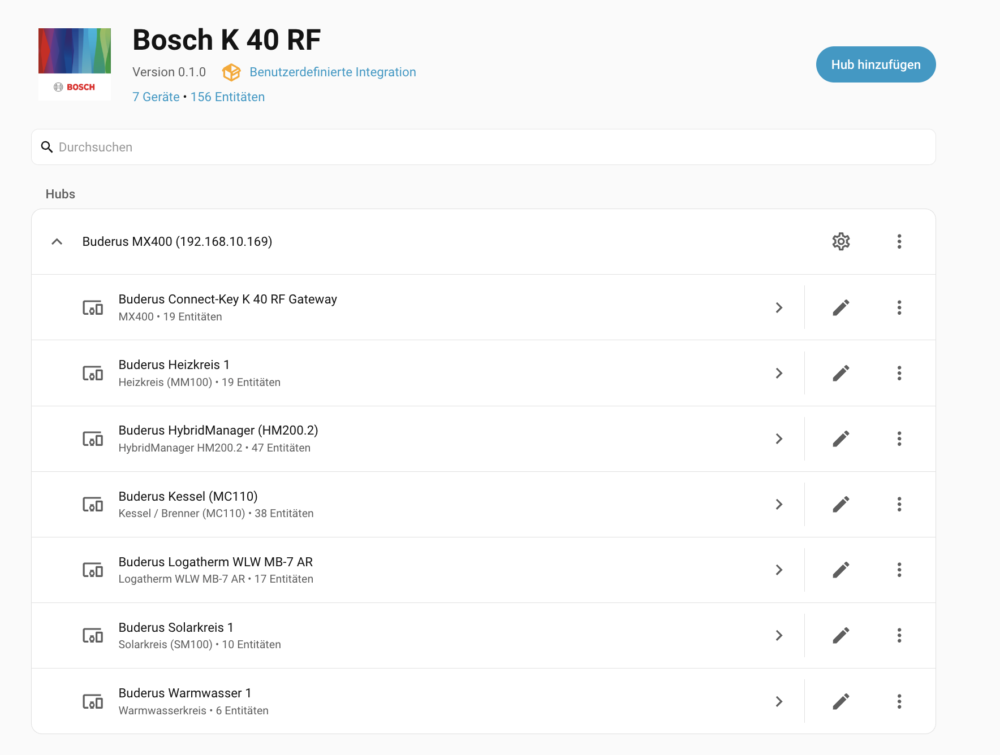
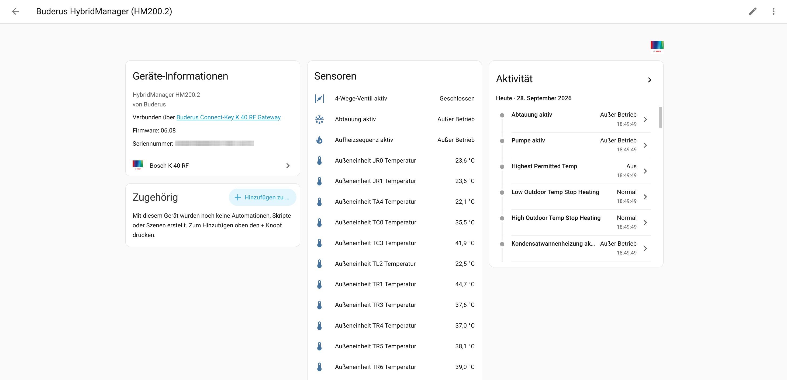

# Bosch Connect-Key K 40 RF / Buderus MX400 Home Assistant Integration

[](https://github.com/hacs/default)
[](https://www.home-assistant.io/)

Custom integration (`bosch_k40rf`) for Home Assistant that reads heat pumps, hybrid systems and heating systems locally, quickly and reliably through the **Bosch Connect-Key K 40 RF** or **Buderus MX400** gateway.

Based on the official specification of the [Bosch Home Comfort Developer API](https://github.com/bosch-home-comfort/api-docs).

---

## Highlights

- **100% local REST API:** Direct communication over the local network – fast, reliable and completely independent of cloud services.
- **Official API compliance:** Based on the official interface specification of the [Bosch Home Comfort Developer API](https://github.com/bosch-home-comfort/api-docs).
- **Broad system support:** Detects heat pumps, boilers, hybrid systems as well as EEBus and Smart Grid states.
- **Structured device hierarchy:** Entities are automatically split across the gateway and the individual system components (heating circuits, domestic hot water, solar circuits, ventilation, room controllers and wireless thermostats).
- **Dynamic discovery:** Only creates entities for functions that actually exist in your system and prevents phantom sensors.
- **Simple & secure pairing:** Local token authentication directly on the gateway, confirmed with a button press.
- **Multilingual:** Entity names and the setup dialog are available in English, German and Dutch and follow the language of your Home Assistant instance (English is used as fallback).

---

## Screenshots

### Device overview
Automatic detection and assignment of all system components (gateway, heating circuits, boiler, heat pump, solar circuit, domestic hot water):



### Device details & sensors
Clear presentation of all live operating values, temperatures and status information:



---

## Technical details

| Property | Value |
| :--- | :--- |
| **Domain** | `bosch_k40rf` |
| **Authentication port** | `9442` (HTTPS POST `/auth/token`) |
| **Data port** | `9443` (HTTPS GET with bearer token) |
| **Protocol** | Local HTTPS (`verify_ssl=False` because of self-signed gateway certificates) |
| **Minimum firmware** | `15.00.01` (Bosch Connect-Key K 40 RF / Buderus MX400) |
| **Scan interval** | 60 seconds (default) |
| **API reference** | [Bosch Home Comfort API Docs](https://github.com/bosch-home-comfort/api-docs) |

---

## Requirements

- **Supported gateways:** Bosch Connect-Key K 40 RF or Buderus MX400 (and the identical IVT / Vulcano / Worcester K 40 RF).
- **Minimum firmware:** Gateway firmware **`15.00.01`** or newer (Bosch only provides the local REST interface from this version onwards).
- **Network:** The gateway and Home Assistant must be on the same local network.
- **Physical access:** For the one-time pairing, the buttons on the gateway must be pressed (proof of physical proximity).

---

## Installation

### Option A: Installation via HACS (recommended)

1. Open **HACS** in your Home Assistant instance.
2. Click the three-dot menu in the top right and choose **Custom repositories**.
3. Add the URL of this repository and select **Integration** as the category.
4. Click **Download** and then restart Home Assistant.

### Option B: Manual installation

1. Download or clone the repository.
2. Copy the `custom_components/bosch_k40rf` folder into your Home Assistant configuration directory:
   ```bash
   cp -r custom_components/bosch_k40rf /path/to/homeassistant/config/custom_components/
   ```
3. Restart Home Assistant.

---

## Configuration & pairing

1. Have the credentials from the label on your gateway (Connect-Key K 40 RF or Buderus MX400) ready:
   - **IP address or hostname**
   - **Login**
   - **Password** (hyphens may be entered or left out)
2. In Home Assistant, go to **Settings -> Devices & services -> Add integration**.
3. Search for **Bosch K 40 RF** (or `Buderus MX400`).
4. **Important before submitting:** Press the **WLAN** and **Wireless buttons** on the gateway **simultaneously for 1 second**, so the LEDs briefly flash blue (proof of physical proximity).
5. Enter the details in the form and click **Submit**.
6. The integration authenticates, detects all available system components and sets up the entities automatically.

---

## API documentation & acknowledgements

This project uses the official specifications and schemas of the:
- **[Bosch Home Comfort Developer API Documentation](https://github.com/bosch-home-comfort/api-docs)** (OpenAPI specification for Connect-Key K 40 RF / Buderus MX400).

Many thanks to the Bosch Home Comfort Group for providing the open interface documentation for local control and monitoring.
